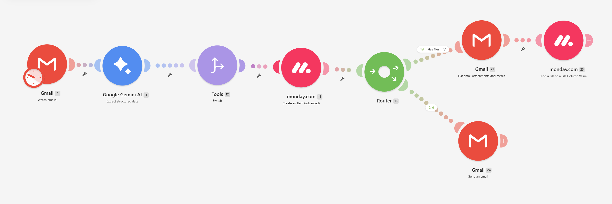
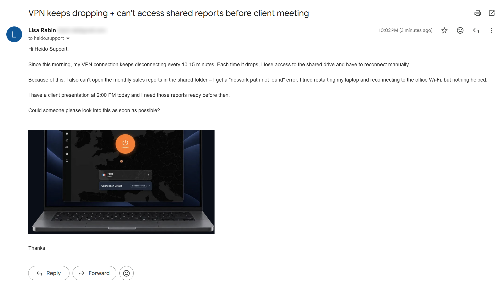
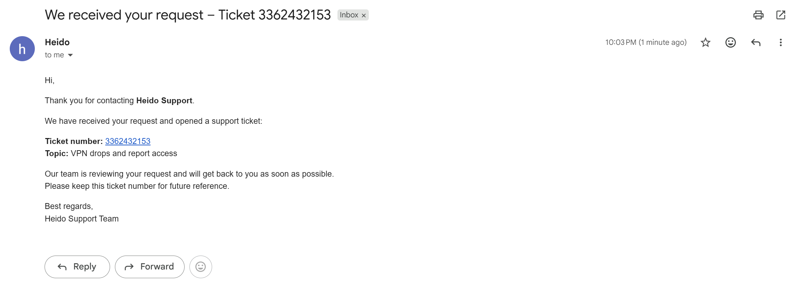
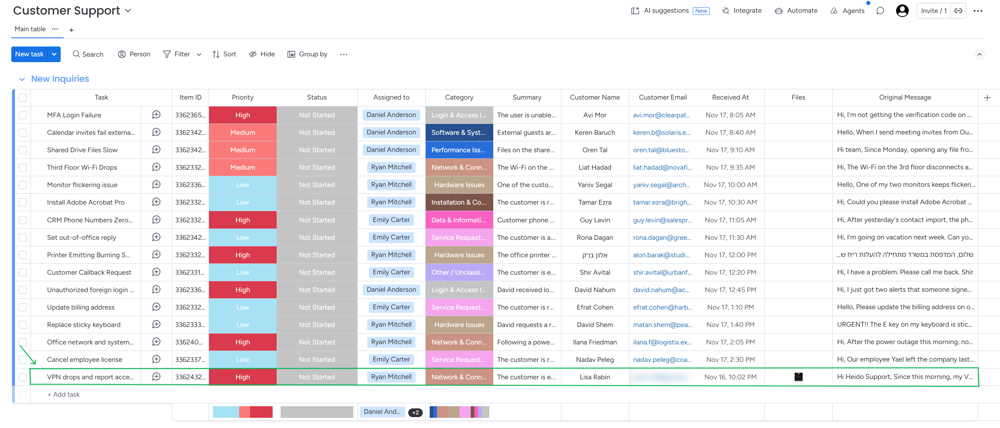

# AI Inquiry Triage – Workflow Automation

An AI-powered automation that reads incoming customer support emails, classifies them by category and priority, and creates an assigned task on the support team's monday.com board – with no manual sorting.

Built with **Make**, **Google Gemini API**, **Gmail** and **monday.com**.

> 🎬 **Demo video:** _link coming soon_
> 📊 **Test report:** [PDF](docs/Alisiya_Rabinovich_AI_Triage_Test_Report.pdf) · [Excel](docs/Heido_AI_Triage_Test_Report.xlsx)

---

## The problem

In many support teams, every incoming email is read and sorted by hand: someone decides what it is about, how urgent it is, and who should handle it. This is slow, inconsistent, and urgent issues can wait in the inbox behind routine requests.

**Heido** is a fictional IT services company created for this project. Its support inbox receives emails about login problems, network outages, broken hardware, billing questions and more.

## The solution

Every new email is processed automatically:

1. **Gmail** – a new email arrives in the support inbox.
2. **Google Gemini** – the AI reads the subject and text and returns a short **title**, a one-sentence **summary**, a **category** and a **priority** (High / Medium / Low) in a fixed format.
3. **Routing rule** – a fixed rule (not the AI) assigns the responsible employee based on the category.
4. **monday.com** – a task is created on the "Customer Support" board with all the details.
5. **Attachments** – if the email has files, they are added to the task.
6. **Confirmation** – the customer receives an email with a ticket number.



## Categories and routing

| Category | Assigned to |
|---|---|
| Login & Access Issues · Software & System Issues · Performance Issues | Daniel Anderson – Software & Application Support |
| Network & Connectivity Issues · Hardware Issues · Installation & Configuration | Ryan Mitchell – IT & Infrastructure Support |
| Data & Information Issues · Service Requests & General Support · Other / Unclassified | Emily Carter – Data & Service Support |

**Priority** is based on business impact, not on the customer's wording:
- **High** – a service is down, someone cannot work, data loss, a security or safety risk, or a same-day deadline is blocked
- **Medium** – something does not work properly, but the customer can still work
- **Low** – requests, questions, planned tasks, minor issues

## Testing

An AI can make mistakes, so the system was tested before being trusted.

- A copy of the scenario read test emails from a Google Sheet instead of Gmail, so many cases could be run at once.
- **Development set** – 15 realistic test emails with known correct answers, used to improve the prompt.
- **Holdout set** – 15 new emails written after the prompt was finished and never used to change it.

| Run | Prompt | Test set | Category | Priority | Assignee |
|---|---|---|---|---|---|
| Baseline | v1 | Development | 87% | 100% | 87% |
| Final | v2 | Development | 93% | 100% | 93% |
| Holdout | v2 | New cases | **100%** | 93% | **100%** |

### What was tested and how

| Risk | How it was tested | Result |
|---|---|---|
| **Overfitting** – works only on the cases it was tuned on | Final prompt run once on 15 unseen holdout emails | Category 100% – no sign of overfitting |
| **Regression** – a fix that breaks a case that used to work | All 15 development emails re-run after every prompt change | An intermediate version broke 3 cases and was rejected; v2 broke nothing v1 had passed |
| **Prompt injection** – email text that tries to give orders to the AI | Two emails with hidden instructions in opposite directions (lower a real outage / raise a routine request) | Both classified by the real problem in every run |
| **Routing** – the task reaches the right employee | Routing done by a fixed rule; expected employee checked for every email | Assignee accuracy equal to category accuracy in every run |

Other cases covered: emails in Hebrew, exaggerated "URGENT" wording, security risks in a calm tone, physical safety risks, vague emails with no details, and several symptoms with one root cause.

Full details, all test emails and results: [test report](docs/Alisiya_Rabinovich_AI_Triage_Test_Report.pdf).

## Live example

A real email with an attached screenshot was sent to the support inbox:

| Customer email | Automatic confirmation |
|---|---|
|  |  |

The task created on the monday.com board (last row) – Network & Connectivity Issues, High, assigned to Ryan Mitchell, with the screenshot in the Files column:



## Design decisions

- **The AI classifies, a rule routes.** The employee is assigned by a fixed rule, so routing is predictable and cannot be manipulated through the email text.
- **Fixed output format.** Gemini returns structured data (title, summary, category, priority), so every task has the same fields.
- **Data minimization.** Only the email subject and text are sent to the AI – not the sender's email address.
- **Business impact over wording.** The prompt tells the AI to ignore words like "urgent" and judge by what actually happens if the issue waits.

## Known limitations

- Tested on 30 realistic but self-written emails, not real customer data.
- Vague emails with no details remain the weakest case.
- No automatic retry yet if the AI service is temporarily unavailable.
- Each test was run once; AI output can vary slightly between runs on borderline cases.

## Repository contents

```
├── README.md
├── blueprint/   Make scenario export (import via Make → Create a new scenario → ⋯ → Import Blueprint)
├── docs/        Test report (PDF and Excel)
├── images/      Screenshots
├── prompts/     Prompt v1 (baseline) and v2 (final)
└── test-data/   Development and holdout test emails (CSV)
```

To use the blueprint, import it into Make and connect your own Gmail, Gemini and monday.com accounts. No API keys are included.

## Author

**Alisiya Rabinovich** – B.A. in Management Information Systems, Peres Academic Center

_All company names, people and email addresses in this project are fictional, except for the live example sender, whose address is blurred._
